# SmartCity360 Project Guide

> **Scope and evidence.** This guide describes behavior visible in the checked-in Java, JSP, SQL, XML, and web assets. It does not infer production behavior from labels or class names. “Simulated” means the application changes its own database records; no external city equipment or city data service is shown in the source. Credentials, hashes, and secret values are intentionally excluded.

## 1. Project Overview

SmartCity360 is an academic/demo city-operations web application. Its source presents a single operations console for:

- Citizen service complaints and staff escalation.
- A parent/child smart-zone hierarchy and recursively simulated operations.
- Simulated streetlight fleet creation with shared configurations.
- Simulated energy-meter stream transformations.
- A small, manually evaluated city-policy expression language.
- User accounts and role assignment.

It demonstrates those operational topics alongside five design-pattern examples. Its SQL repositories persist the application records to MySQL, but the README and UI explicitly describe city operations as simulated. There is no source path to an IoT device, utility meter, streetlight controller, GIS, notification service, or external policy-enforcement system.

**Stack confirmed by project files:** Java 17, Jakarta EE 10 Servlet/JSP API, Payara 6 as the documented target runtime, JDBC, MySQL, Maven WAR packaging, and browser HTML/CSS/JavaScript. `pom.xml` configures Java release 17, Jakarta EE API 10 as provided, JUnit 5, and jBCrypt. The UI is JSP with Jakarta Tags and a local stylesheet (`assets/css/dashboard.css`); the Maven build does not declare Tailwind or a Tailwind build step, so Tailwind use cannot be confirmed from this project’s build/source.

The architecture is a conventional servlet MVC arrangement: annotated servlets call application services, JDBC repositories implement persistence, and servlets forward request data to JSPs under `WEB-INF/views`. `AppBootstrap` creates services and repositories and stores service instances in the servlet context.

## 2. Application Architecture

### Request and data flow

1. A browser requests an application path. `/` is redirected to `/dashboard` by `AuthorizationFilter`.
2. `CharacterEncodingFilter` and `AuthorizationFilter` are mapped to `/*`. The latter handles route allowlisting, session authentication, per-request account revalidation, route-role checks, CSRF validation for POST requests, and several response headers.
3. An annotated servlet parses the request, obtains a service from the servlet context, and supplies view data.
4. The service validates input and applies business rules. It calls a repository/DAO interface.
5. `Jdbc*Repository` classes obtain a connection via `ConnectionProvider`, which looks up `java:comp/env/jdbc/SmartCity360`, and issue prepared SQL against MySQL.
6. The servlet forwards to a JSP under `/WEB-INF/views` or redirects after a successful POST. JSPs render escaped values using Jakarta Tags. Local JavaScript provides client-side search, filters, pagination, confirmations, sidebar behavior, and form-submit feedback.

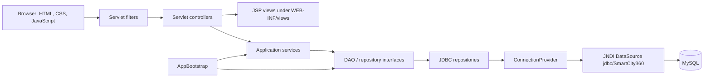

### Concrete layers

| Layer | Actual implementation |
|---|---|
| Views | `login.jsp`, `dashboard.jsp`, `complaints.jsp`, `user-management.jsp`, `smart-zones.jsp`, `streetlights.jsp`, `security-streams.jsp`, `policies.jsp`, plus header/footer fragments. |
| Controllers | `LoginServlet`, `LogoutServlet`, `UserManagementServlet`, `DashboardServlet`, `ComplaintServlet`, `SmartZoneServlet`, `StreetlightServlet`, `SecurityStreamServlet`, `PolicyServlet`. |
| Services | `AuthenticationService`, `UserManagementService`, `DashboardService`, `ComplaintService`, `SmartZoneService`, `StreetlightService`, `SecurityStreamService`, `PolicyService`. |
| Persistence | `JdbcUserRepository`, `JdbcComplaintRepository`, `JdbcZoneRepository`, `JdbcStreetlightRepository`, `JdbcStreamRunRepository`, `JdbcPolicyRepository`, and `DashboardRepository`. |
| Startup/configuration | `AppBootstrap` constructs the services; `ConnectionProvider` obtains JDBC connections through JNDI. `web.xml` declares the resource reference, session timeout, cookie HttpOnly setting, and welcome file. |

`BaseServlet` supplies JSP forwarding, request error attributes, and positive-ID parsing helpers. There is no separate front-controller servlet, ORM, or dependency-injection framework in the inspected source.

## 3. User Roles and Permissions

The roles are exactly `CITY_MANAGER`, `SUPERVISOR`, `LOCAL_STAFF`, and `RESIDENT` in `UserRole`. The sidebar in `fragments/header.jspf` is presentation logic; actual page authorization comes from the route-role map in `AuthorizationFilter`, with additional actor checks in `UserManagementService` and `ComplaintService`.

| Role | Intended responsibility stated by the UI/code | Pages allowed by server filter | Complaint visibility and actions | Other restrictions |
|---|---|---|---|---|
| `CITY_MANAGER` | Manage accounts and access the five pattern modules; handle manager-level complaints. | `/dashboard`, `/complaints`, `/logout`, `/user-management`, `/security-streams`, `/smart-zones`, `/streetlights`, `/policies`. | Sees all complaints; can escalate/resolve a complaint when it is at `CITY_MANAGER` and assignment rules permit. Can submit no complaint through this role. | User management methods independently require a City Manager. Cannot deactivate own account or demote self; safeguards preserve at least one active City Manager. |
| `SUPERVISOR` | Process complaints routed to supervisors. | `/dashboard`, `/complaints`, `/logout`. | Sees all complaints and their descriptions; can act only on a complaint whose current handler is `SUPERVISOR` and which is not assigned to a different active supervisor. Cannot submit a complaint. | Other module routes return 403 even if manually entered; route filter does not grant access merely because a URL is known. |
| `LOCAL_STAFF` | Process complaints routed to local staff. | `/dashboard`, `/complaints`, `/logout`. | Sees all complaints and their descriptions; can act only on a complaint whose current handler is `LOCAL_STAFF` and which is not assigned to a different active Local Staff member. Cannot submit a complaint. | Other module routes return 403. |
| `RESIDENT` | Submit complaints and follow their own complaint records. | `/dashboard`, `/complaints`, `/logout`. | Can submit. `ComplaintService` restricts list and history reads to records owned by that resident; cannot escalate or resolve. | Other module routes return 403. |

`/sign-in`, `/assets/*`, and `/favicon.ico` are public. Unknown non-public servlet paths are rejected with 404. Staff complaint lists are not filtered to assigned complaints: `ComplaintService.all()` returns all complaints for any authenticated non-resident role. Consequently, the JSP’s staff copy about private intake details should not be read as an authorization guarantee; complaint descriptions from other residents are included in the staff table. Resident names are not included in the `ComplaintView`.

## 4. Sidebar and Page-by-Page Documentation

The shared navigation is defined in `fragments/header.jspf`; there are no separate role-specific sidebars. For every role, **Overview** and **Complaints** are shown. Only City Managers see the four additional pattern-module links (**Security streams**, **Smart zones**, **Streetlights**, **City policies**) and **User management**. All server-side rules in the preceding table apply independently of menu visibility.

### City Manager sidebar

| Sidebar label / URL | Purpose, displayed information, and available actions | Controller → service → DAO/repository; tables | Rules and status |
|---|---|---|---|
| Overview — `/dashboard` (`dashboard.jsp`) | Shows aggregate stream-run, zone, open-complaint, streetlight, active-policy counts and platform status. Module shortcut links are shown to a City Manager. No data-changing button. | `DashboardServlet` → `DashboardService.loadStats()` → `DashboardRepository`; reads `security_stream_run`, `smart_zone`, `complaint`, `streetlight`, `city_policy`. | Database-backed counts; status copy also contains fixed/static wording. Operationally simulated. |
| Complaints — `/complaints` (`complaints.jsp`) | Lists complaints and history; City Manager can escalate or resolve a case currently at manager level. Search, severity/status filters and pagination are browser-only. | `ComplaintServlet` → `ComplaintService.all/history/escalate/resolve` → `JdbcComplaintRepository`; assignment lookup uses `JdbcUserRepository`. Reads/writes `complaint`, `complaint_escalation`, and reads `app_user`. | Implemented record workflow. Escalation by the final handler records `FINAL_HANDLING`, does not resolve; explicit Resolve is separate. |
| Security streams — `/security-streams` (`security-streams.jsp`) | Enter meter ID and energy value, optionally select Compression, Encryption, Authentication; inspect latest 20 saved original/encoded runs. | `SecurityStreamServlet` → `SecurityStreamService.process/recentRuns` → `JdbcStreamRunRepository`; `security_stream_run`. | Simulated input and persisted output. Encryption/authentication need configured environment keys; no read-back verification/decryption flow. |
| Smart zones — `/smart-zones` (`smart-zones.jsp`) | View/search/collapse hierarchy; add a city or child node; run recursive power shutdown or usage report for a selected subtree. | `SmartZoneServlet` → `SmartZoneService.rows/add/execute` → `JdbcZoneRepository`; `smart_zone`, `zone_operation`. | Hierarchy and operations are persisted. Shutdown sets power off; report summarizes stored values. No restore-power or edit/delete control. |
| Streetlights — `/streetlights` (`streetlights.jsp`) | Create a simulated fleet with location, optional zone and configuration; see total lights, unique persisted configs, in-memory cache size, and latest 50 lights. | `StreetlightServlet` → `StreetlightService.createBatch/recent/totalLights/uniqueConfigurations/cachedConfigurations` → `JdbcStreetlightRepository` and `StreetlightFactory`; `streetlight`, `streetlight_config`, optional FK to `smart_zone`. | Batch creation is implemented and persisted. No update/delete/status action; new records default to ON. |
| City policies — `/policies` (`policies.jsp`) | Create/edit an expression, activate/deactivate, manually evaluate against typed values, and inspect recent evaluations/errors. | `PolicyServlet` → `PolicyService.save/policies/evaluate/recentEvaluations` → `JdbcPolicyRepository`; `city_policy`, `policy_evaluation`. | Parser and evaluation are implemented. Evaluation is manual with supplied values; it does not enforce policies against city systems. |
| User management — `/user-management` (`user-management.jsp`) | Create account; list users; change role, activate/deactivate, reset password. Search/filter are client-side. | `UserManagementServlet` → `UserManagementService` → `JdbcUserRepository`; `app_user`. | City Manager checks exist in the service. No delete, username change, or email change action. |

### Supervisor sidebar

| Sidebar label / URL | Purpose and actions | Controller → service → repository; tables | Status / authorization |
|---|---|---|---|
| Overview — `/dashboard` (`dashboard.jsp`) | Same aggregate counts and system status as other roles; no role-filtered dashboard query. | `DashboardServlet` → `DashboardService` → `DashboardRepository`; reads `security_stream_run`, `smart_zone`, `complaint`, `streetlight`, `city_policy`. | Accessible. Aggregate counts are database-backed, not scoped to the supervisor. |
| Complaints — `/complaints` (`complaints.jsp`) | View the all-complaints table and history; escalate or resolve only cases at the supervisor level and not assigned to another active supervisor. | `ComplaintServlet` → `ComplaintService` → `JdbcComplaintRepository` and `JdbcUserRepository`; `complaint`, `complaint_escalation`, `app_user`. | Accessible and service-checked. Visibility is broader than action permission: descriptions of other residents’ complaints are returned. |

### Local Staff sidebar

| Sidebar label / URL | Purpose and actions | Controller → service → repository; tables | Status / authorization |
|---|---|---|---|
| Overview — `/dashboard` (`dashboard.jsp`) | Same aggregate counts and status information as other roles. | `DashboardServlet` → `DashboardService` → `DashboardRepository`; reads `security_stream_run`, `smart_zone`, `complaint`, `streetlight`, `city_policy`. | Accessible; no role-scoped metrics. |
| Complaints — `/complaints` (`complaints.jsp`) | View the all-complaints table and history; escalate or resolve only cases at the Local Staff level and not assigned to another active Local Staff member. | `ComplaintServlet` → `ComplaintService` → `JdbcComplaintRepository` and `JdbcUserRepository`; `complaint`, `complaint_escalation`, `app_user`. | Accessible and service-checked. Visibility includes other residents’ descriptions. |

### Resident sidebar

| Sidebar label / URL | Purpose and actions | Controller → service → repository; tables | Status / authorization |
|---|---|---|---|
| Overview — `/dashboard` (`dashboard.jsp`) | Same aggregate operational counts and status; the page does not hide staff-module totals from residents. | `DashboardServlet` → `DashboardService` → `DashboardRepository`; reads `security_stream_run`, `smart_zone`, `complaint`, `streetlight`, `city_policy`. | Accessible; metrics are global aggregates. |
| Complaints — `/complaints` (`complaints.jsp`) | Submit a description and severity; list and inspect history for the resident’s own complaints. Search/filter/pagination run in the browser. | `ComplaintServlet` → `ComplaintService.submit/all/history` → `JdbcComplaintRepository`; reads/writes `complaint`, `complaint_escalation`, and reads `app_user` to choose an active initial handler. | Implemented with server-side ownership checks and validation. Resident cannot process complaints. |

### Pages and endpoints not presented as sidebar pages

- `/sign-in` is the public login page (`LoginServlet` → `login.jsp`).
- `/logout` is a POST endpoint that invalidates the session; it does not render a page.
- `WEB-INF/views/fragments/header.jspf` and `footer.jspf` are included JSP fragments, not standalone pages.
- The JSPs are under `WEB-INF`, so they are intended to be reached through servlet forwards rather than direct browser URLs.
- `/` redirects to `/dashboard`, which then requires authentication.
- No other JSP page is present in `src/main/webapp` in the inspected project tree.

### Common page interactions

`dashboard.js` implements client-side filtering/search/pagination for marked tables, zone search and collapse, submit confirmation (including power shutdown and large fleet creation), and form submit feedback. It does **not** implement the `data-password-toggle` control used by the login page; the “Show” password button has no matching handler in this script. The CSS/HTML table filters do not fetch fresh server data.

## 5. Complete User Workflows

### A. Login and logout

1. The unauthenticated user requests a protected GET; the filter redirects to `/sign-in?required=1`.
2. `LoginServlet.doGet` serves `login.jsp`. The filter creates a random CSRF token in the session.
3. The form POST is checked for CSRF by `AuthorizationFilter`.
4. `LoginServlet.doPost` calls `AuthenticationService.authenticate(identifier,password)`. `JdbcUserRepository.findByIdentifier` queries username or email in `app_user`; `BCryptPasswordHasher` verifies the password hash and inactive or invalid accounts are rejected with a common login error.
5. On success, the session ID is changed, `authenticatedUser` is stored, a new CSRF token is generated, and the browser is redirected to `/dashboard`.
6. On every protected request, the filter reloads the account by ID, updates the session principal (so active/role changes take effect), and checks the route role.
7. Logout is a CSRF-protected POST to `/logout`; `LogoutServlet` invalidates the session and redirects to `/sign-in?logout=1`.

```mermaid
sequenceDiagram
    actor U as User
    participant B as Browser
    participant F as AuthorizationFilter
    participant L as LoginServlet
    participant A as AuthenticationService
    participant R as JdbcUserRepository
    participant DB as MySQL
    U->>B: Open protected page
    B->>F: GET /dashboard
    F-->>B: Redirect /sign-in?required=1
    B->>F: GET /sign-in
    F->>F: Create session CSRF token
    F->>L: Forward request
    L-->>B: login.jsp
    U->>B: Submit identifier and password + CSRF
    B->>F: POST /sign-in
    F->>L: CSRF valid
    L->>A: authenticate()
    A->>R: findByIdentifier()
    R->>DB: SELECT app_user
    DB-->>R: Account/hash/role/active
    A-->>L: AuthenticatedUser or common error
    L->>L: Rotate session ID; set principal and fresh CSRF
    L-->>B: Redirect /dashboard
    U->>B: Sign out (POST + CSRF)
    B->>F: POST /logout
    F->>L: Permit authenticated role
    L->>L: Invalidate session
```

### B. City Manager account management

The City Manager opens `/user-management`. The servlet loads role names and `UserManagementService.all(actor)`; the service checks the actor role before the DAO selects non-hash account fields. POST actions are `create`, `active`, `role`, and `password`. Creation validates name, username, email, supported role, and password before hashing and inserting. Role/access/password changes each pass the service’s City Manager check. Self-deactivation/self-demotion and removing the last active City Manager are blocked. Updates affect `app_user`; the service has no delete operation. There is no public registration flow; initial account bootstrapping is described in README and requires an operator-managed database action.

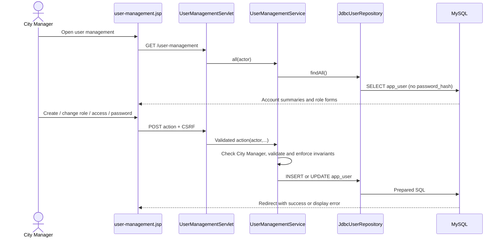

### C–G. Resident complaint submission, assignment, escalation, resolution, tracking

- Submission is available only to `RESIDENT` (`ComplaintService.submit`). Description must be 8–2,000 characters and severity must be `LOW`, `MEDIUM`, or `HIGH`.
- `ComplaintHandlerChain.handlerFor` assigns initial handler by severity: Low → Local Staff, Medium → Supervisor, High → City Manager. This means medium/high complaints do **not** necessarily pass through Local Staff first.
- The service generates an `SC-...` reference and asks `UserRepository` for the first active account at that handler role. If no such user exists, `assigned_user_id` is null. The DAO transaction inserts a complaint and a `SUBMITTED` history entry together.
- Non-residents can list all complaints. A resident can list only their own and can only open history for their own record. Staff action methods require a handler role, the complaint’s current handler to match that role, and no assignment to another active same-role user. If the assigned user is absent/inactive/has another role, the conditional DAO update allows the matching handler role to act.
- Escalate moves Local Staff → Supervisor → City Manager. The target is assigned to the first active account for the next role, if available. Each move and history row commit in one transaction. At City Manager, another escalation records `FINAL_HANDLING` at City Manager and leaves the complaint open/in progress; it is not a transition to a separate resolution role. A later separate Resolve action sets status `RESOLVED`. A `FINAL_HANDLING` entry prevents further escalation.
- The complaint page offers buttons only when `currentHandler` matches the signed-in non-resident role and status is not resolved, but server-side service and conditional SQL enforce the meaningful restrictions. The hidden `currentHandler` form field is not used as authorization input.
- Successful actions redirect to the complaint list/selected history. `ComplaintService.history` reads ordered history records.

```mermaid
sequenceDiagram
    actor Resident
    participant UI as complaints.jsp
    participant C as ComplaintServlet
    participant S as ComplaintService
    participant H as ComplaintHandlerChain
    participant UR as JdbcUserRepository
    participant CR as JdbcComplaintRepository
    participant DB as MySQL
    Resident->>UI: Submit description + severity
    UI->>C: POST /complaints action=submit + CSRF
    C->>S: submit(actor, description, severity)
    S->>H: handlerFor(severity)
    H-->>S: Initial handler by severity
    S->>UR: findFirstActiveIdByRole(initial role)
    UR->>DB: SELECT active handler
    S->>CR: create(complaint, initial assignee)
    CR->>DB: Transaction: INSERT complaint + SUBMITTED history
    DB-->>UI: Redirect with complaint list
    actor Staff as Current handler
    Staff->>UI: Escalate or resolve eligible case
    UI->>C: POST /complaints action + complaint ID + CSRF
    C->>S: escalate() or resolve()
    S->>CR: Read complaint and history; enforce handler/assignment
    S->>H: escalationFrom(current) if escalate
    H-->>S: Next level or FINAL_HANDLING
    S->>CR: Conditional update + history in one transaction
    CR->>DB: UPDATE complaint; INSERT complaint_escalation
    DB-->>UI: Redirect; updated status/history visible
```

### H. Smart-zone creation and hierarchy management

`GET /smart-zones` calls `rows()`, which loads all `smart_zone` records and builds/validates the composite tree. An Add POST chooses the type from the parent: no parent means City, then City → District → Street → Building. Names are 1–120 characters and sibling names are checked case-insensitively; only Buildings may have nonzero usage. `JdbcZoneRepository` validates the parent under a transaction and persists the new node. A Run POST invokes a subtree operation. `REPORT_USAGE` reports stored building readings and a subtree total; `SHUTDOWN_POWER` sets every affected node’s `power_on` false and records a completed `zone_operation`. No operation changes external infrastructure.

### I. Streetlight creation and management

`GET /streetlights` loads the latest 50 `streetlight` rows and counts light/config records. A form POST validates 1–10,000 lights, a 1–150-character location, configuration ranges and enum-like values, and an optional positive zone ID. `StreetlightFactory` interns the immutable `LightConfiguration`. The service creates unique simulated codes and pole locations. In one DAO transaction, `streetlight_config` is inserted or reused by its unique configuration key, then batch rows are inserted into `streetlight`; the optional zone FK is checked by MySQL. The application does not implement editing, deleting, turning off, or placing lights on a map.

### J. Streetlight configuration and Flyweight reuse

Within one running application instance, `StreetlightFactory` uses a concurrent map keyed by record-value equality to reuse `LightConfiguration` objects. Across requests, persisted configuration reuse is additionally done by MySQL’s unique key and `ON DUPLICATE KEY UPDATE`. The cache count is per application instance and is not a database-wide metric; persisted unique configurations are counted from `streetlight_config`.

### K. Security Stream processing using Decorator

`POST /security-streams` validates meter ID and finite energy range, accepts a distinct subset of the three named decorators, and selects a deterministic order: Compression, Encryption, Authentication. A JSON-like payload is created in the service, starting with `RawMeterStream`; successive wrappers produce compression → encryption → HMAC at runtime. Binary output is Base64 encoded before persistence. `JdbcStreamRunRepository` stores original and processed payloads plus the displayed chain. Compression uses GZIP; encryption uses AES-GCM with a fresh IV; authentication appends HMAC-SHA256. Encryption/HMAC keys come from environment variables, not the database. `AuthenticationDecorator.verify()` exists, but no service, controller, DAO, or view invokes it. No decrypt/decompress verification or external meter ingestion is implemented.

### L. City Policy creation and evaluation using Interpreter

The City Manager saves a policy using `PolicyService.save`; the service validates its name, parses the expression, checks duplicate names, then persists it. The grammar supports only comparisons using `<`, `<=`, `=`, `>=`, `>` joined by `AND`, with `NOISE_LEVEL` and `PARKING_HOUR` variables. Evaluation loads an active policy, parses supplied `NAME=value;...` inputs, checks the required variables, interprets the expression, and stores result or validation error in `policy_evaluation`. The UI is a manual test harness; policy evaluation does not source live noise/parking data or enact city rules.

### M. Dashboard data loading

`DashboardServlet` sets `webApplicationStatus` to `RUNNING`, checks whether the five module service attributes exist, then calls `DashboardService.loadStats()`. `DashboardRepository` executes one query of scalar counts from five tables. On successful query the page marks database status `CONNECTED` and exposes the `DashboardStatsView`; a runtime failure is logged and leaves stats absent/“UNAVAILABLE”. Dashboard counts are aggregate and not role-filtered. “Web application RUNNING” is a servlet-set status, not an independent infrastructure health probe.

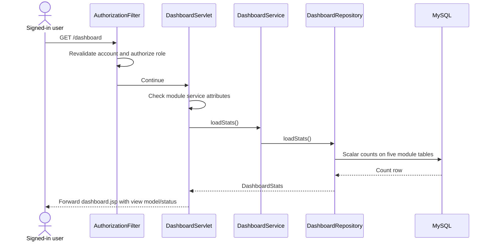

## 6. Role Hierarchy Diagram

The app role hierarchy is best understood as responsibilities, not a general permission-inheritance scheme. The route filter grants the City Manager additional module routes; staff/resident permissions are separately enforced by complaint/user services.

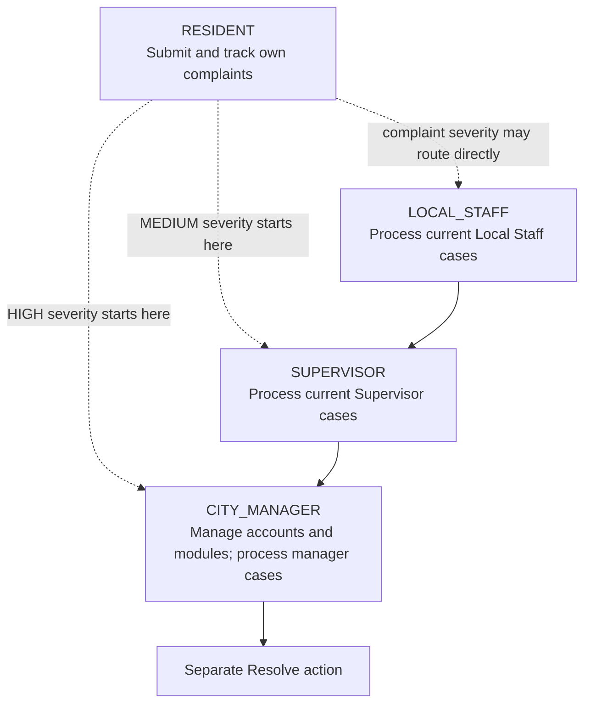

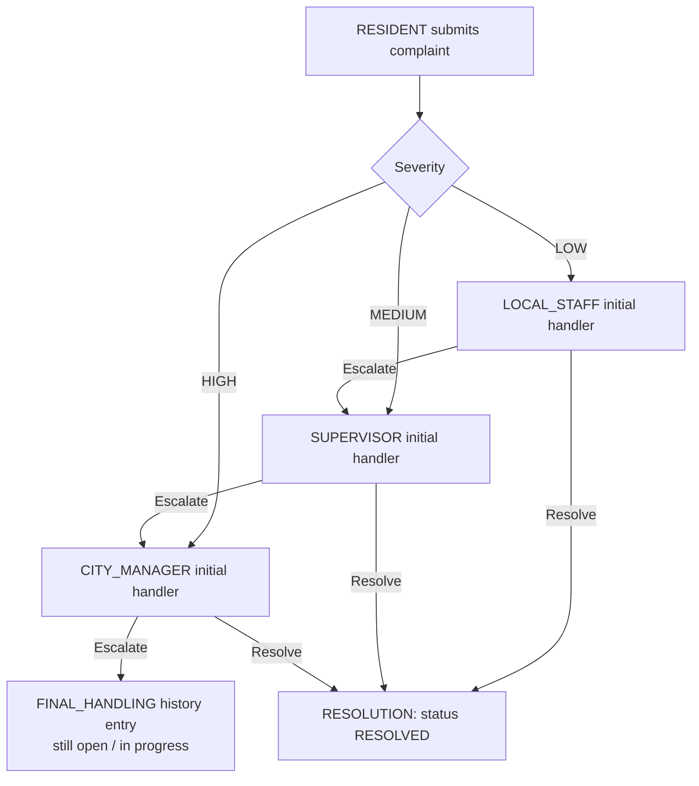

Thus the requested simple Resident → Local Staff → Supervisor → City Manager → Resolution sequence is **not exactly the implementation**: severity may route directly to Supervisor or City Manager, and the Manager’s final escalation records final handling without resolving. Resolution is a separate action available to the current handler.

## 7. Design Pattern Analysis

### A. Decorator — security wrappers for data streams

- **Purpose in this code:** Dynamically wrap `StreamProcessor` implementations to transform a meter payload.
- **Classes:** `StreamProcessor` is the component interface; `RawMeterStream` clones input bytes; `StreamDecorator` holds a delegate; `CompressionDecorator`, `EncryptionDecorator`, and `AuthenticationDecorator` add GZIP, AES-GCM, and HMAC-SHA256 behavior.
- **Interaction:** `SecurityStreamService.process` constructs the wrapper chain according to validated selections. Selected order is fixed regardless of checkbox ordering. The service Base64-encodes output and saves it.
- **Tables:** `security_stream_run`.
- **Completeness:** Demonstration of encoding wrappers and persistence is implemented. No verification/decryption/decompression workflow uses the stored output; authentication generation must not be confused with a caller-verified authenticity result.

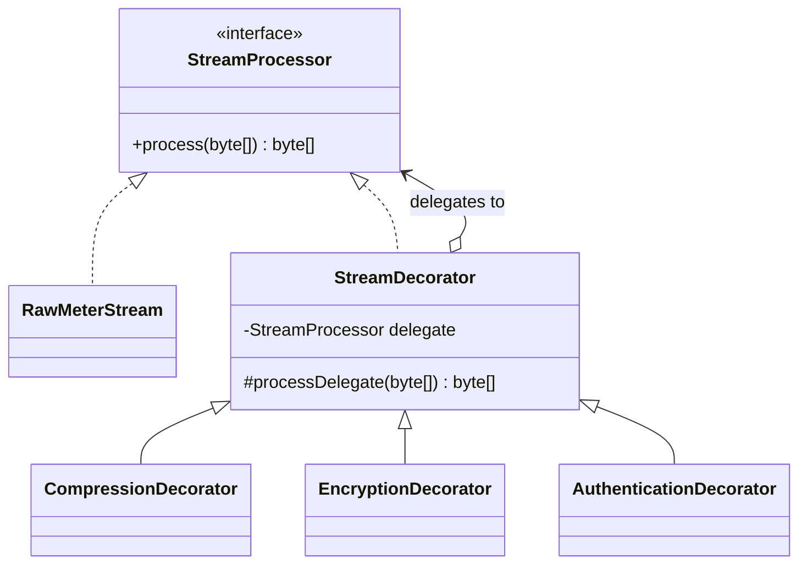

### B. Composite — hierarchical smart zones

- **Purpose:** Treat a zone and its descendants uniformly for traversal, operation execution, ID collection, and usage aggregation.
- **Classes:** `ZoneComponent` defines record/execute/zone IDs/usage; `ZoneComposite` stores children; `ZoneLeaf` represents a building; `ZoneType` defines the allowed hierarchy; `SmartZoneService` builds, validates, flattens, renders, and executes trees.
- **Interaction:** Service loads records from `ZoneRepository`, creates components and links parent-child objects, validates acyclicity/connectivity/type, and recursively executes an operation from any selected subtree.
- **Tables:** `smart_zone`, `zone_operation`.
- **Completeness:** In-memory composite traversal and persistent add/operation logging are implemented. The only leaf type is Building; no zone edit/delete or power restoration UI exists.

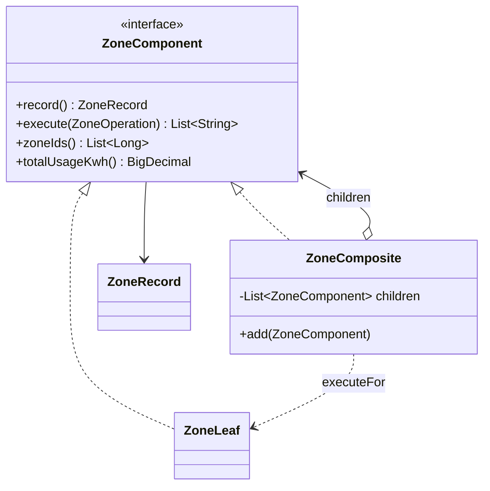

### C. Chain of Responsibility — complaint escalation

- **Purpose:** Route an initial severity and advance an unresolved complaint through progressively higher handler levels.
- **Classes:** `ComplaintHandler` interface; `AbstractComplaintHandler` implements acceptance, forwarding, and escalation; `LocalStaffHandler`, `SupervisorHandler`, and `CityManagerHandler` define levels/responsibilities and accepted initial severity; `ComplaintHandlerChain` links them; `ComplaintService` enforces actor, ownership, assignment, and status rules.
- **Interaction:** The chain starts at Local Staff for severity resolution (`LOW` Local Staff, `MEDIUM` Supervisor, `HIGH` City Manager). For escalation it returns the next handler; the final manager returns `FINAL_HANDLING` at the manager level.
- **Tables:** `complaint`, `complaint_escalation`, and `app_user` for assignees.
- **Completeness:** Workflow and history persistence are implemented. There is no distinct escalation-to-resolution handler; City Manager final handling remains open until explicit resolution. Initial severity bypasses lower levels where applicable.

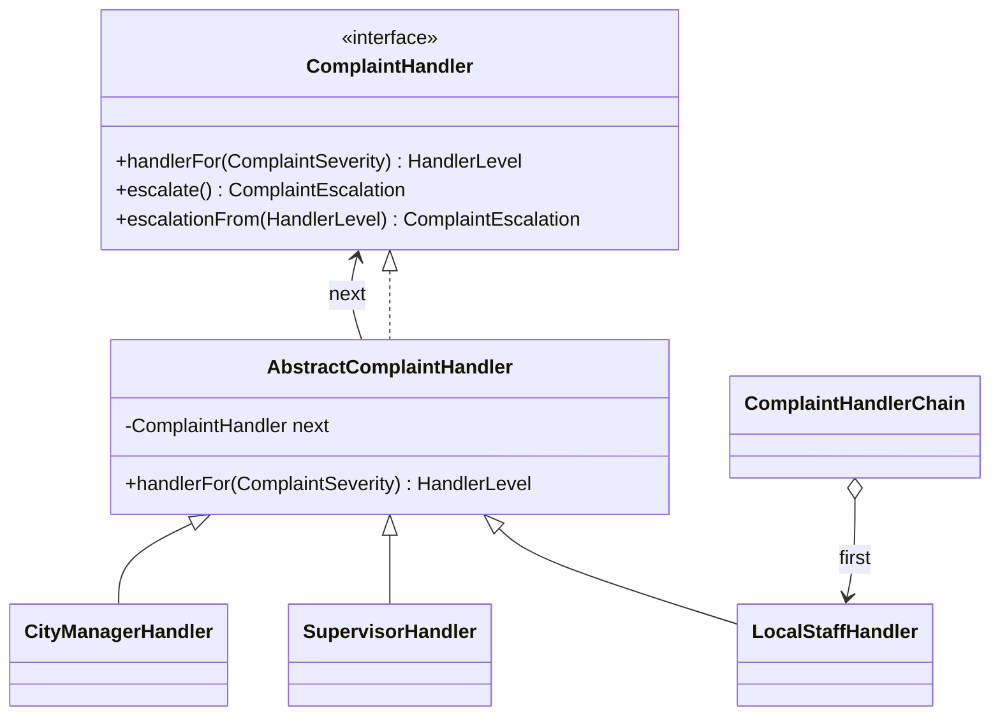

### D. Flyweight — smart streetlight configuration

- **Purpose:** Reuse immutable state common to many streetlight instances.
- **Classes:** `LightConfiguration` is an immutable record with validation; `StreetlightFactory` interns equal configurations in a `ConcurrentHashMap`; `Streetlight` keeps per-light code/location/zone/status plus configuration; `StreetlightService` builds batches.
- **Interaction:** The factory shares configuration objects in one app instance. The DAO separately inserts/reuses a database configuration row via a unique composite key and links lights by `config_id`.
- **Tables:** `streetlight_config`, `streetlight`, optionally `smart_zone`.
- **Completeness:** In-memory and database reuse are implemented. The cache is process-local; “streetlight management” currently creates fleets but does not manage existing light state.

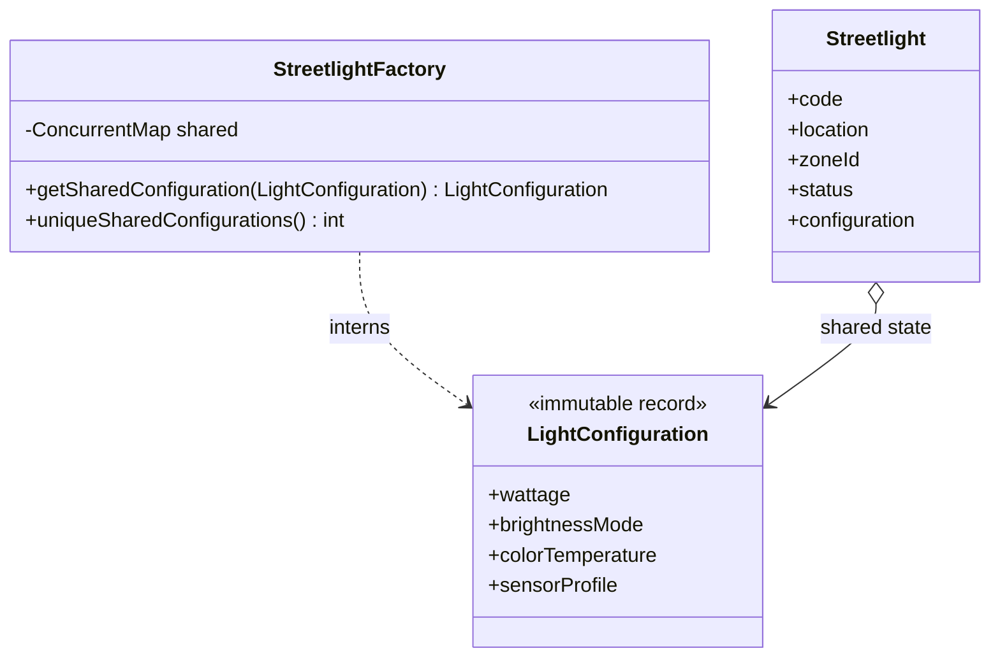

### E. Interpreter — city policy DSL

- **Purpose:** Parse and evaluate a constrained Boolean rule language rather than arbitrary code.
- **Classes:** `PolicyParser` parses comparisons and AND terms; `Expression` is the expression interface; `ComparisonExpression` evaluates one comparison; `AndExpression` evaluates all terms; `PolicyContext` supplies numeric values; `PolicyService` validates/persists/evaluates.
- **Interaction:** The service parses on save and evaluation; it validates supplied values and evaluates through the expression tree.
- **Tables:** `city_policy`, `policy_evaluation`.
- **Completeness:** The small grammar is implemented and bounded. It supports only two variables, comparisons, and AND; no parentheses, OR, live sensor input, or automatic enforcement is present.

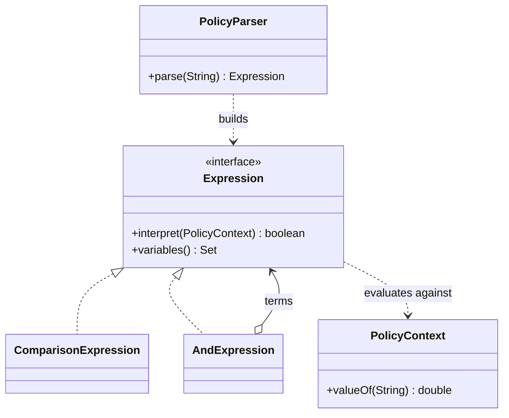

## 8. Database Documentation

The complete baseline schema is `src/main/resources/db/schema.sql`. Migrations are `V2__smart_zone_state.sql`, `V3__unique_root_zone_names.sql`, and `V4__role_based_authentication.sql`. There is no V1 migration in the inspected tree. The baseline schema already includes the current zone state, generated root key, user/auth columns, and complaint ownership/assignment columns. Migration scripts are upgrade scripts for an earlier schema and should not be blindly applied to an already-current baseline.

### Tables, columns, keys, and application use

| Table | Columns (type; nullability/default; purpose) | Keys, indexes, relationships; module |
|---|---|---|
| `security_stream_run` | `id` BIGINT auto PK; `meter_id` VARCHAR(80) NOT NULL; `decorator_chain` VARCHAR(255) NOT NULL; `original_payload` LONGTEXT NOT NULL; `processed_payload` LONGTEXT NOT NULL; `created_at` TIMESTAMP NOT NULL DEFAULT current time. | Read/insert by stream DAO; aggregate dashboard count. No foreign keys. |
| `smart_zone` | `id` BIGINT auto PK; `parent_id` BIGINT NULL self-parent; `parent_key` generated stored BIGINT = `COALESCE(parent_id,0)`; `zone_type` ENUM CITY/DISTRICT/STREET/BUILDING; `name` VARCHAR(120); `power_on` BOOLEAN DEFAULT true; `usage_kwh` DECIMAL(12,3) DEFAULT 0; `created_at` TIMESTAMP. | `parent_id` FK to `smart_zone.id`; `uq_zone_sibling_name(parent_id,name)`; `uq_zone_sibling_name_root_safe(parent_key,name)`; `idx_zone_parent`. Used by Composite and optional streetlight placement; dashboard count. |
| `zone_operation` | `id` BIGINT auto PK; `root_zone_id` BIGINT; `operation_type` ENUM SHUTDOWN_POWER/REPORT_USAGE; `status` VARCHAR(24); `result_summary` TEXT; `created_at` TIMESTAMP. | `root_zone_id` FK to `smart_zone.id`; `idx_zone_operation_date`. Inserted for simulated zone operations; no actor column or UI history query. |
| `app_user` | `id` BIGINT auto PK; `full_name` VARCHAR(120); `username` VARCHAR(64); `email` VARCHAR(254); `password_hash` VARCHAR(60); `role` ENUM RESIDENT/LOCAL_STAFF/SUPERVISOR/CITY_MANAGER; `active` BOOLEAN DEFAULT true; `created_at`, `updated_at` timestamps. | Unique username and email; `idx_app_user_role_active(role,active)`. Authentication, user management, complaint assignee/resident/history actor. |
| `complaint` | `id` BIGINT auto PK; `reference_no` VARCHAR(32) NOT NULL; `description` TEXT; `severity` ENUM LOW/MEDIUM/HIGH; `status` ENUM OPEN/IN_PROGRESS/RESOLVED DEFAULT OPEN; `current_handler` ENUM LOCAL_STAFF/SUPERVISOR/CITY_MANAGER; `resident_id` BIGINT NULL; `assigned_user_id` BIGINT NULL; `created_at`, `updated_at` timestamps. | Unique reference; resident and assigned-user FKs to `app_user`; indexes on status/severity, resident/date, handler/assignee/status. Complaint workflow and dashboard open-count. |
| `complaint_escalation` | `id` BIGINT auto PK; `complaint_id` BIGINT; `handler_level` ENUM LOCAL_STAFF/SUPERVISOR/CITY_MANAGER; `actor_user_id` BIGINT NULL; `actor_role` ENUM all four roles NULL; `action` VARCHAR(24); `note` VARCHAR(500) NULL; `occurred_at` TIMESTAMP. | Complaint FK with ON DELETE CASCADE; actor FK to `app_user`; indexes on complaint/date and actor/date. Complaint audit trail. |
| `streetlight_config` | `id` BIGINT auto PK; `wattage` SMALLINT UNSIGNED; `brightness_mode` VARCHAR(32); `color_temperature` SMALLINT UNSIGNED; `sensor_profile` VARCHAR(48). | Unique four-column configuration key. Flyweight persistence. |
| `streetlight` | `id` BIGINT auto PK; `light_code` VARCHAR(64) NOT NULL; `config_id` BIGINT; `zone_id` BIGINT NULL; `location` VARCHAR(180); `latitude`, `longitude` DECIMAL(10,7) NULL; `status` ENUM ON/OFF/MAINTENANCE DEFAULT ON; `created_at` TIMESTAMP. | Unique light code; config FK; zone FK; index on config. Streetlight module and dashboard count. Application creation does not populate coordinates or update status. |
| `city_policy` | `id` BIGINT auto PK; `name` VARCHAR(120) unique; `expression_text` VARCHAR(500); `active` BOOLEAN DEFAULT true; `created_at`, `updated_at` timestamps. | Unique name. Policy authoring and interpreter evaluation. |
| `policy_evaluation` | `id` BIGINT auto PK; `policy_id` BIGINT NULL; `input_values` JSON NOT NULL; `result` BOOLEAN NULL; `validation_error` VARCHAR(500) NULL; `evaluated_at` TIMESTAMP. | Policy FK with ON DELETE SET NULL; evaluation-date index. Manual policy results/errors. |

The schema uses InnoDB and `utf8mb4`. FKs without an explicit delete action use MySQL’s default restriction behavior. The application does not expose a general delete workflow for users, zones, streetlights, or policies.

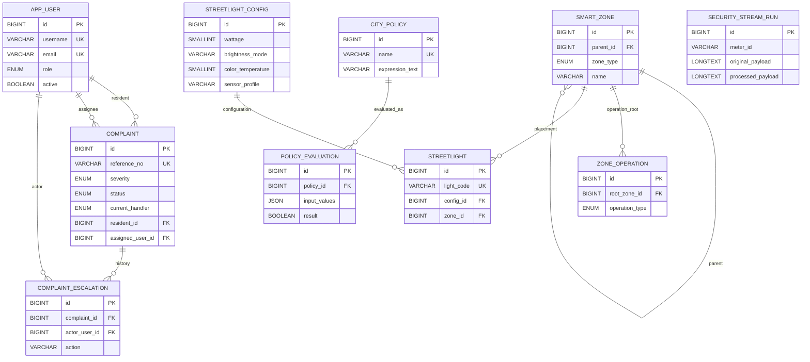

## 9. Authentication and Security

- **Login:** `/sign-in` accepts username or email and password. `AuthenticationService` fetches the account and checks `active` and the password. Invalid/inactive credentials receive the same generic message.
- **Password storage:** `BCryptPasswordHasher` uses jBCrypt with work factor 12. Password input must be at least 12 characters and no more than 72 UTF-8 bytes. The repository selects password hash only for authentication and does not include it in user summaries. README documents operator-managed initial City Manager setup; no public registration is present.
- **Session:** The authenticated principal is stored under `authenticatedUser`. Login changes the session ID, and protected requests revalidate user ID/active state/current role from the database. `web.xml` sets 30-minute inactivity timeout, HttpOnly cookie, and cookie-only tracking. The source does not explicitly configure Secure or SameSite cookie attributes.
- **Authentication and authorization filter:** `AuthorizationFilter` is mapped to `/*`; it permits sign-in/assets/favicon, rejects unknown paths, requires authenticated users on application pages, revalidates the account, then applies the route-role allowlist. It sets `Cache-Control: no-store`, `X-Content-Type-Options`, `X-Frame-Options`, and `Referrer-Policy`. The separate `CharacterEncodingFilter` sets UTF-8.
- **Role checks:** Route access to the five modules and user management is City Manager-only. `UserManagementService` independently checks City Manager. `ComplaintService` independently checks Resident submission, resident ownership, and handler-level processing/assignment. Complaint listing for staff is broader than assigned work.
- **CSRF:** A random 32-byte URL-safe token is held in the session, submitted as `csrfToken`, and compared with `MessageDigest.isEqual` for POST requests (including login and logout). A fresh token is set after successful login.
- **Logout/expiry:** Logout is POST-only in the UI and invalidates the session. A session with a deactivated/deleted user is invalidated on revalidation; account lookup/database failures produce a logged 503 rather than silently accepting the principal.
- **Security limitations confirmed in source:** No login throttling, lockout, MFA, or CAPTCHA code was found. HTTPS enforcement, Secure/SameSite cookie configuration, CSP, and HSTS are not explicitly configured in the inspected app files; deployment proxy/server settings are unknown. `AuthenticationDecorator` can add and verify an HMAC, but only generation is wired. Stream originals are stored and shown in the UI. No external-device authentication or authorization integration is present.

## 10. Navigation Hierarchy

```text
SmartCity360
├── Authentication
│   ├── /sign-in → LoginServlet → WEB-INF/views/login.jsp (public)
│   └── POST /logout → LogoutServlet (authenticated; no view)
├── City Manager
│   ├── Sidebar: Overview, Complaints, Security streams, Smart zones,
│   │            Streetlights, City policies, User management
│   └── Pages
│       ├── /dashboard → dashboard.jsp
│       ├── /complaints → complaints.jsp
│       ├── /security-streams → security-streams.jsp
│       ├── /smart-zones → smart-zones.jsp
│       ├── /streetlights → streetlights.jsp
│       ├── /policies → policies.jsp
│       └── /user-management → user-management.jsp
├── Supervisor
│   ├── Sidebar: Overview, Complaints
│   └── Pages: /dashboard → dashboard.jsp; /complaints → complaints.jsp
├── Local Staff
│   ├── Sidebar: Overview, Complaints
│   └── Pages: /dashboard → dashboard.jsp; /complaints → complaints.jsp
└── Resident
    ├── Sidebar: Overview, Complaints
    └── Pages: /dashboard → dashboard.jsp; /complaints → complaints.jsp
```

The labels and role condition are in `fragments/header.jspf`; route mappings are `@WebServlet` annotations and role enforcement is in `AuthorizationFilter`. The common header/footer are JSP fragments and are not separate navigation destinations.

## 11. Implementation Status and Issues

| Feature | Status | Relevant source | Confirmed limitations / missing functionality | Needs testing |
|---|---|---|---|---|
| Login/session/CSRF | Implemented | `LoginServlet`, `AuthenticationService`, `BCryptPasswordHasher`, `AuthorizationFilter`, `web.xml` | No rate limiting/MFA; cookie Secure/SameSite and HTTPS policy not explicit in app; depends on configured JDBC resource and seeded manager. | Yes: valid/invalid credentials, role changes, inactive account, CSRF, timeout, logout. |
| Role/navigation | Implemented with static JSP visibility and server route checks | `AuthorizationFilter`, `header.jspf` | Only City Manager has module routes; no dedicated Supervisor/Local Staff dashboards. | Yes: direct URL access for all roles. |
| Dashboard | Database-backed counts; status partly static | `DashboardServlet`, `DashboardRepository`, `dashboard.jsp` | `RUNNING` is set by servlet; database status reflects count-query success; aggregate metrics are not role-filtered. | Yes: empty DB, DB failure, role scope expectations. |
| Complaint intake/escalation | Implemented, with partial workflow semantics | `ComplaintService`, chain handlers, complaint DAO/JSP | Severity can start at any of the three levels; manager final handling is not resolution. Staff see all complaint descriptions, not only assigned cases. Null assignment when no active handler allows same-level processing. | Yes: all severities, assignment, direct access, cross-resident ID/history, final manager path, races. |
| Smart zones | Implemented for create, hierarchy display, recursive report/shutdown | `SmartZoneService`, composite classes, `JdbcZoneRepository` | No edit/delete/re-power action; usage can be supplied only when creating Building nodes; reporting only summarizes stored readings; no real facility integration. `zone_operation` is written but no UI history reads it. | Yes: invalid parent/type, duplicate siblings, subtree shutdown/report. |
| Streetlights | Implemented simulated batch generation | `StreetlightService`, `StreetlightFactory`, `JdbcStreetlightRepository` | Creation only; no status/location edit, delete, map, coordinates, or device control. Optional zone relies on DB FK. Cache count is process-local. | Yes: batch limits, config reuse, FK failure, max batch. |
| Security streams | Implemented transform demonstration and persistence | `SecurityStreamService`, decorators, stream DAO | No external source; authentication verification and decryption are not wired; original payload retained/displayed. Encryption/HMAC fail if configured key is absent/invalid. | Yes: each decorator, combinations/order, missing key, invalid input, round-trip expectations (not currently provided). |
| City policies | Implemented bounded DSL save/evaluate | `PolicyService`, `PolicyParser`, expression classes, policy DAO | Manual values only; no live data or automatic enforcement. No `OR`, parentheses, arithmetic, or policy action. | Yes: supported grammar, unsupported syntax, inactive rule, missing/extra/duplicate inputs. |
| User management | Implemented create/list/role/activation/password reset | `UserManagementService`, `UserManagementServlet`, `JdbcUserRepository` | No delete, username/email update, self-deactivate/demote, or public registration. Initial manager needs operator bootstrap. | Yes: each role as actor, last manager safeguards, uniqueness, weak/oversized passwords. |
| Login password visibility button | Non-functional control in inspected JavaScript | `login.jsp`, `dashboard.js` | `data-password-toggle` appears in the JSP but no handler appears in `dashboard.js`; “Show” does not toggle the input in the inspected script. | Yes: browser interaction. |
| Front-end styling/build | Local CSS exists; Tailwind not confirmed | `assets/css/dashboard.css`, `pom.xml` | No Tailwind dependency/build configuration in Maven; do not assume Tailwind utilities are compiled. | Only if Tailwind is an explicit requirement. |
| Placeholder or hardcoded operational data | No fake database dashboard counts found | `DashboardRepository`, JSPs | Dashboard count values are queried. Static labels/status and default sample form values (`MTR-001`, `42.8`, etc.) are presentation defaults, not telemetry. All simulated records are app-generated. | Yes: verify defaults are understood as demo inputs. |

## 12. Testing Guide

Use provisioned test accounts for each role; this guide intentionally includes no credentials. Exercise in a non-production database. There are JUnit test sources for authentication, user management, complaint service/chain, zones/composite, streetlights/factory, policy parser, stream decorators/service, and view bean properties; this guide does not claim that tests were run in this read-only documentation task.

### City Manager

- Sign in; verify Overview counts/status and all seven navigation links.
- Open each module via the sidebar and by direct URL. Confirm each page renders from database state.
- User management: create one test account for each supported role, try duplicate username/email, invalid role/password, activate/deactivate, change role, and reset password. Verify self-deactivation/self-demotion is rejected and at least one active City Manager remains.
- Complaints: submit is not offered for this role. Check that the manager can act only on manager-level cases and that final handling does not set `RESOLVED`; test the separate Resolve action.
- Zone: create City → District → Street → Building, try invalid parent/type and duplicate sibling, report usage, shut down subtree, then inspect persisted power state.
- Streetlights: create repeated configuration batches and verify unique config count/reused config IDs; test count 0, 10,001, invalid config, and nonexistent optional zone.
- Streams: process with no decorators and with each permitted combination. With keys configured, inspect output; without them, selecting Encryption or Authentication should produce a visible server error rather than a successful run.
- Policies: create and edit valid rules, evaluate true/false cases, and test inactive policy, missing input, duplicate values, unsupported variable/operator, and malformed `AND`.

### Supervisor

- Sign in; verify only Overview and Complaints appear.
- Manually request `/security-streams`, `/smart-zones`, `/streetlights`, `/policies`, and `/user-management`; expect 403.
- Check complaint table visibility and history. Attempt escalation/resolution for a supervisor-level assigned case, then test a case at another handler level and one assigned to another active supervisor. Confirm only eligible actions succeed.
- Verify resident-only submission is rejected by service/server even if a POST is crafted.

### Local Staff

- Sign in; verify only Overview and Complaints appear; test manager-only direct URLs return 403.
- Review complaints and history; confirm actions are available only for Local Staff-level cases and server rejects a case assigned to another active staff member.
- Test Low severity intake routes to Local Staff, while Medium and High route directly to their configured levels.

### Resident

- Sign in; verify only Overview and Complaints appear and module routes return 403.
- Submit valid Low, Medium, and High complaints; test missing severity, too-short, and oversized descriptions.
- Confirm each resident sees only their own complaint list/history; try another resident’s complaint ID in history/actions and expect no disclosure.
- Attempt crafted escalation/resolution POST; expect rejection.
- Confirm dashboard counts remain global as implemented, rather than assuming they are resident-specific.

### Cross-role and edge cases

- POST without a valid CSRF token on sign-in, complaints, user management, each module, and logout; expect 403.
- Deactivate a signed-in test user, then request a protected page; the next revalidation should expire the session.
- Change a test user’s role and verify the next request uses the new role.
- Test malformed numeric IDs, invalid enumerations, duplicate submissions, concurrent complaint action, database unavailable behavior, session idle timeout, and direct access to JSP paths under `WEB-INF`.
- In the browser, test table search/filter/pagination, zone collapse/search, shutdown/bulk confirmations, and alert dismissal. Verify the login “Show” control separately; no handler is present in the inspected JavaScript.

## 13. Complete Application Flow Summary

SmartCity360 is a role-controlled web console that keeps city-operation demo records in MySQL. A user signs in; the server checks the account and current role on every protected request. Residents submit complaints. The complaint chain sends them to a handler based on severity, then staff can move eligible cases upward or resolve them. City Managers also create a tree of simulated city zones, generate simulated streetlight fleets, transform sample meter payloads, and define/evaluate simple policies. The dashboard reads aggregate counts from the database.

The five pattern modules do not all interact with all four roles:

| Role | Decorator streams | Composite zones | Complaint chain | Flyweight lights | Interpreter policies |
|---|---|---|---|---|---|
| Resident | No route access | No route access | Submit and track own cases | No route access | No route access |
| Local Staff | No route access | No route access | Process eligible Local Staff cases; can see all complaint rows | No route access | No route access |
| Supervisor | No route access | No route access | Process eligible Supervisor cases; can see all complaint rows | No route access | No route access |
| City Manager | Run simulated transforms | Create hierarchy and run simulated operations | Process eligible City Manager cases; full list | Create simulated fleets | Author/evaluate manual rules |

Every module change is an application/database operation, not a verified command to a real city system. The explicit supported outcomes are database rows, status changes, computed summaries, and rendered evaluation results.

## 14. Glossary

| Term | Meaning in this project |
|---|---|
| Active account | `app_user.active = TRUE`; the filter and authentication service require active status. |
| Assigned handler | Optional user ID in `complaint.assigned_user_id`, selected as the first active account for the target role. |
| Chain of Responsibility | Complaint handler objects that choose an initial level by severity and produce escalation outcomes. |
| Composite | A zone node may contain child nodes and execute an operation recursively. |
| CSRF token | Random session token required on POST forms and compared by the global authorization filter. |
| Decorator | A stream processor wrapper that applies compression, encryption, or a message authentication code around another processor. |
| DSL | The restricted city-policy language: numeric comparisons on `NOISE_LEVEL`/`PARKING_HOUR`, joined with `AND`. |
| Flyweight | Shared immutable `LightConfiguration`; street-specific code/location/zone/status remains per instance. |
| Final handling | `FINAL_HANDLING` history action at City Manager level. It does not resolve the complaint. |
| Handler level | `LOCAL_STAFF`, `SUPERVISOR`, or `CITY_MANAGER`, distinct from the `RESIDENT` role. |
| JNDI DataSource | Payara-managed JDBC resource looked up by `ConnectionProvider` using `java:comp/env/jdbc/SmartCity360`. |
| Policy evaluation | Manual evaluation of an active saved expression against user-supplied values, with result/error persisted. |
| Simulated operation | An operation that updates SmartCity360’s own records without controlling external infrastructure. |
| Stream authentication | HMAC-SHA256 signature generation in the decorator. The app does not wire payload verification into its stream workflow. |
| Zone | A database node in the allowed hierarchy City → District → Street → Building. |
